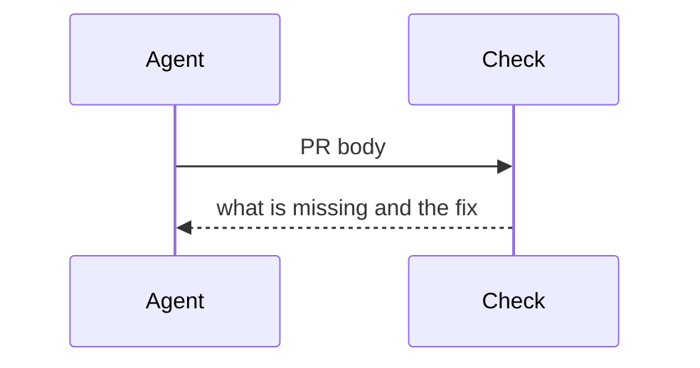

~~~
$ git rev-parse HEAD
1f0e2d3c4b5a69788796a5b4c3d2e1f0a9b8c7d6
$ npm test
# pass 49
$ npm run check
(no output past the npm banner)
~~~

## Summary

## Evidence

- **Before:** `node checks/run-pr-body.js body.md` printed nothing.
  **After:** it printed one line per missing section.

## Merge Danger

**Door:** one-way

**Blast Radius:** none

<!-- This is an auto-generated comment: release notes by coderabbit.ai -->

## Summary by CodeRabbit

* **New Features**
  * Adds a PR body check.
